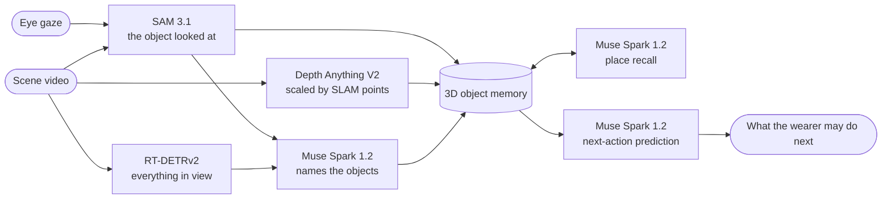
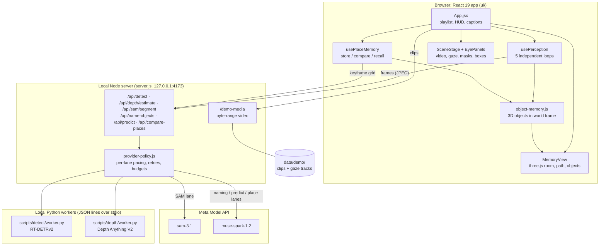
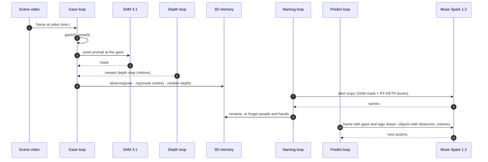
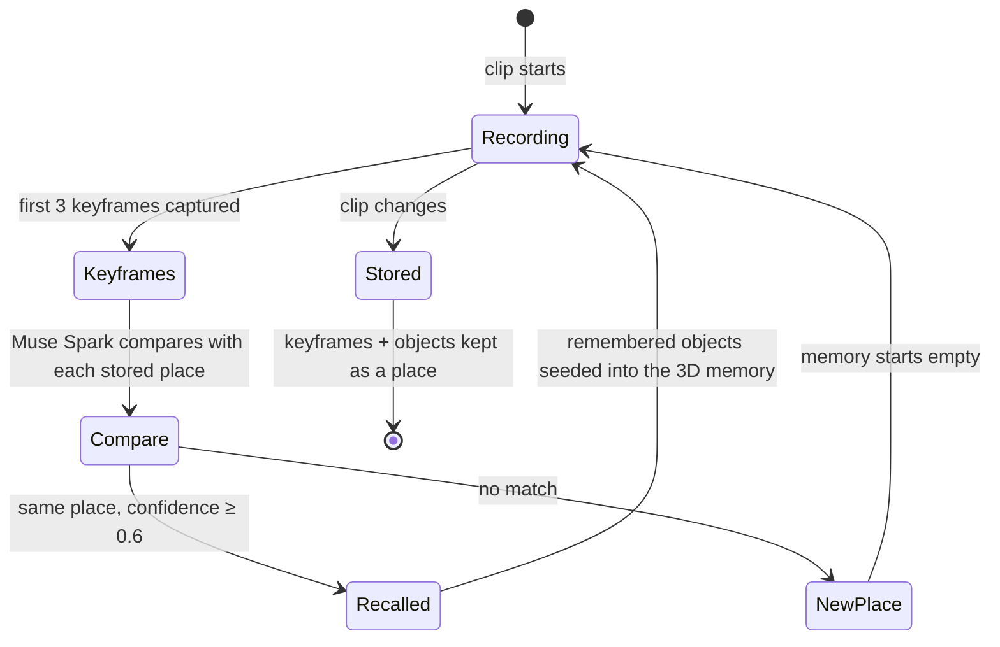
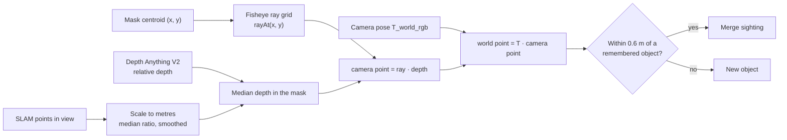
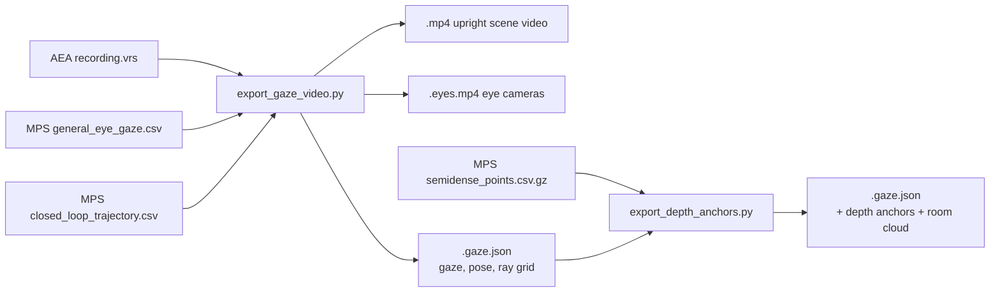

<div align="center">


**See where you look. Remember where things are. Predict what you do next.**

[](LICENSE)
[](https://nodejs.org/)
[](https://react.dev/)
[](https://www.python.org/)
[](#meta-models)
[](#meta-models)
[](#tests)

[Quick start](#running-it) · [Architecture](#architecture) · [Demo data](#demo-data) · [Contributing](CONTRIBUTING.md) · [Attributions](ATTRIBUTIONS.md)

</div>

> [!NOTE]
> Prometheus is an independent hackathon project. It is not affiliated with or endorsed by Meta; it calls Meta's
> models through the public Meta Model API.

**Prometheus watches where you look and predicts what you will do next.** It follows the wearer's eye gaze through
egocentric glasses video, segments whatever they look at with SAM 3.1, places it in a 3D memory of the room with metric
depth, and asks Muse Spark for open next-action predictions grounded in that gaze and memory. When the wearer comes
back to a place it has seen before, it recognises the place and recalls the objects it remembers there.

Built for the Meta Global AI Developer Hackathon (October 26 to November 4, 2026). Everything in this repository was
written during the hackathon; third-party models, datasets and libraries are listed in [ATTRIBUTIONS.md](ATTRIBUTIONS.md).

## Features



- **Gaze-grounded segmentation.** The wearer's gaze point is the SAM 3.1 prompt, so the mask is the object they are
  actually looking at, not every object in the frame. RT-DETRv2 boxes cover the rest of the scene and stand in for SAM
  when it is rate limited.
- **Objects named by Muse Spark.** Detector and SAM crops are tiled into one image and Muse Spark names them, so the
  memory holds "Scrabble board" or "laundry basket" instead of a fixed detector class list.
- **3D object memory.** Each object's mask (or box) depth, scaled to metres with SLAM points, is turned into a world
  point with the camera pose. Repeated sightings merge, people and hands are dropped, and the memory view shows the
  objects in the room's point cloud along the wearer's path.
- **Place memory and recall.** When the clip changes, the current place is stored with a keyframe grid. Muse Spark
  compares a new place with the stored ones; on a match the remembered objects come back into the 3D memory, marked as
  recalled until they are seen again.
- **Next-action prediction.** Every few seconds Muse Spark gets the frame with the gaze and object tags drawn on it,
  the object list with distances, and what the memory recalls from earlier visits, and answers with up to three short
  predictions of what the wearer may do next.

All perception loops run independently (detection, depth, SAM at the gaze, naming, prediction), so a slow model never
blocks the others.

## Architecture

### Components

The browser app does the capture, overlay and memory; the local server keeps the API key, rate-limits every provider
and runs the two local models as long-lived Python workers.



### Perception loops

Each loop paces itself and reads the newest result of the others from shared state, so a slow call delays only its own
output.

| Loop | Runs | Input | Output |
|---|---|---|---|
| Detect | back to back | 640 px frame | RT-DETRv2 boxes with distances from the latest depth map |
| Depth | back to back | 320 px frame | depth map, rescaled to metres with the SLAM points in view |
| Gaze | every 1.5 s | frame + gaze point + pose | SAM 3.1 mask (RT-DETR box as fallback), world point into the memory |
| Naming | every 5 s | SAM crop + up to 5 detector crops, tiled | Muse Spark names; renames the memory object, drops people and hands |
| Predict | every 3 s | annotated frame, object list, memory | up to 3 next-action predictions |



### Place memory



When a recalled object is seen again it is merged with the new sighting; until then it is drawn as recalled in the
memory view and offered to the predictor as an earlier visit.

### 3D memory geometry



### Offline export



## Meta models

| Model | Role |
|---|---|
| SAM 3.1 (`sam-3.1`) | Segments the object at the gaze point |
| Muse Spark 1.2 (`muse-spark-1.2`, minimal effort) | Names objects, compares places, predicts next actions |

Both are called through the Meta Model API from the local server; the key stays on the server.

## Demo data

The demo uses four recordings from one home in the **Aria Everyday Activities (AEA) dataset**:
`loc2_script3_seq1_rec1`, `loc2_script2_seq6_rec1`, `loc2_script5_seq2_rec1` and `loc2_script3_seq1_rec2`
(RGB scene video, eye-camera video, MPS eye gaze, MPS closed-loop trajectory and MPS semi-dense points). Because they
share an MPS world frame, the place memory can be tested across separate recordings of the same rooms.

> This work uses the Aria Everyday Activities Dataset, provided by Meta Platforms, Inc. under the
> [AEA Dataset License](https://www.projectaria.com/datasets/aea/license/) for non-commercial research.

The dataset and any clips derived from it are **not included** in this repository. To run the demo, request access to
AEA yourself at [projectaria.com/datasets/aea](https://www.projectaria.com/datasets/aea/), accept its license, download
the sequences above with the official downloader, and export them as described below.

## Running it

Requirements: Windows 10/11 (the local model setup is a PowerShell script), Node.js 20.17+ or 22.9+, Python 3.12, FFmpeg on `PATH`, and a Meta Model API key.

```sh
npm ci
```

Local models (CPU): Depth Anything V2 Metric Hypersim Small and RT-DETRv2. On Windows the setup script creates the
pinned Python environment in `.asset-tmp/depth-runtime` and downloads the depth checkpoint; RT-DETRv2 is fetched from
Hugging Face on first start.

```powershell
pwsh -NoProfile -File scripts\depth\setup.ps1
.asset-tmp\depth-runtime\venv312\Scripts\python.exe -m pip install transformers==4.57.1
```

Export each AEA sequence into `data/demo/` (needs `pip install projectaria-tools==1.7.1`):

```sh
python scripts/aria/export_gaze_video.py --vrs <seq>/recording.vrs \
  --gaze <seq>/mps/eye_gaze/general_eye_gaze.csv \
  --trajectory <seq>/mps/slam/closed_loop_trajectory.csv \
  --seconds 100000 --out data/demo/aria_loc2_script3_seq1_rec1
python scripts/aria/export_depth_anchors.py --track data/demo/aria_loc2_script3_seq1_rec1.gaze.json \
  --points <seq>/mps/slam/semidense_points.csv.gz
```

`data/demo/playlist.json` lists the clips the app plays, in order. Then start the server:

```powershell
$env:META_API_KEY = '<your key>'
$env:PROMETHEUS_COMPUTE_PROFILE = 'local'
npm start
```

Open <http://127.0.0.1:4173/?autostart>. The left side plays the scene video with the gaze, masks, boxes and
predictions; the right side shows the eye cameras and the 3D memory.

## Repository layout

| Path | Contents |
|---|---|
| `ui/` | React 19 app (Vite): `hooks/usePerception.js` runs the perception loops, `hooks/usePlaceMemory.js` the place memory, `components/MemoryView.jsx` the three.js memory view |
| `server.js`, `server/` | Local Node server: SAM 3.1 adapter, Muse Spark namer, predictor and place comparer, provider rate limits, local detector and depth workers |
| `src/spatial/object-memory.js` | 3D object memory: world points from pose, ray and depth; merge, rename, forget, recall |
| `src/gaze/` | Gaze track replay: gaze, pose, camera rays and depth anchors at any video time |
| `scripts/aria/` | AEA export: upright RGB video, eye video, gaze, poses, fisheye ray grid, SLAM depth anchors |
| `scripts/detect/`, `scripts/depth/` | Local RT-DETRv2 and Depth Anything V2 workers (JSON lines over stdio) |
| `test/` | Node test suite (`npm test`) |

The `/classic` page, `docs/` and the gate records are from the earlier webcam-gaze prototype built in the first days of
the hackathon; the current app is the React page at `/`.

## Tests

```sh
npm test
```

The suite uses Node's built-in test runner and runs without a Meta API key; live-model checks are separate scripts in
`scripts/verify-*.js`.

## Contributing

Issues and pull requests are welcome. Read [CONTRIBUTING.md](CONTRIBUTING.md) first; it covers setup, tests, commit
style and the one hard rule: never commit dataset media or API keys. Report security problems privately as described in
[SECURITY.md](SECURITY.md). Everyone taking part follows the [Code of Conduct](CODE_OF_CONDUCT.md).

## License

Prometheus is released under the [MIT License](LICENSE).

Third-party models, datasets, libraries and fonts keep their own licenses; see [ATTRIBUTIONS.md](ATTRIBUTIONS.md). No
dataset media is distributed here: the AEA dataset is used under its own license and is credited to Meta Platforms, Inc.

## Team

**Project Prometheus**: Mingyu Jeong ([@Mingoomato](https://github.com/Mingoomato))
